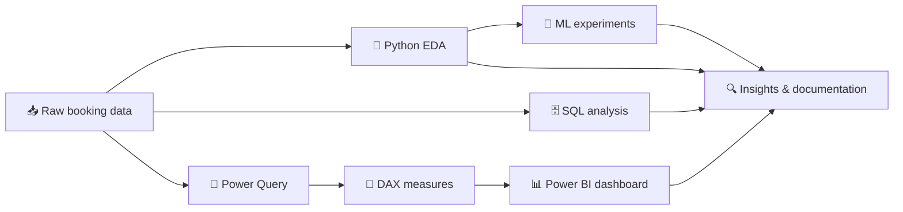
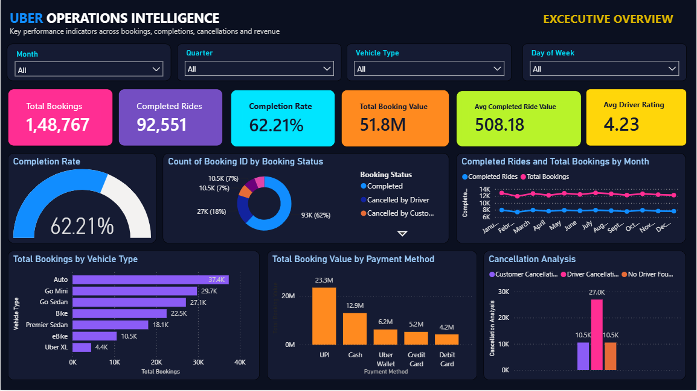
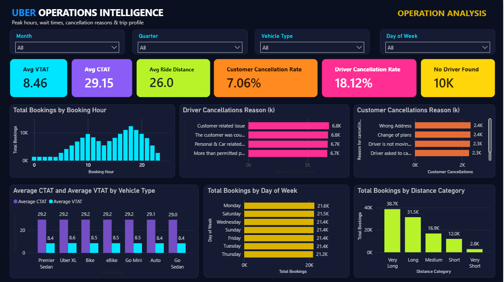
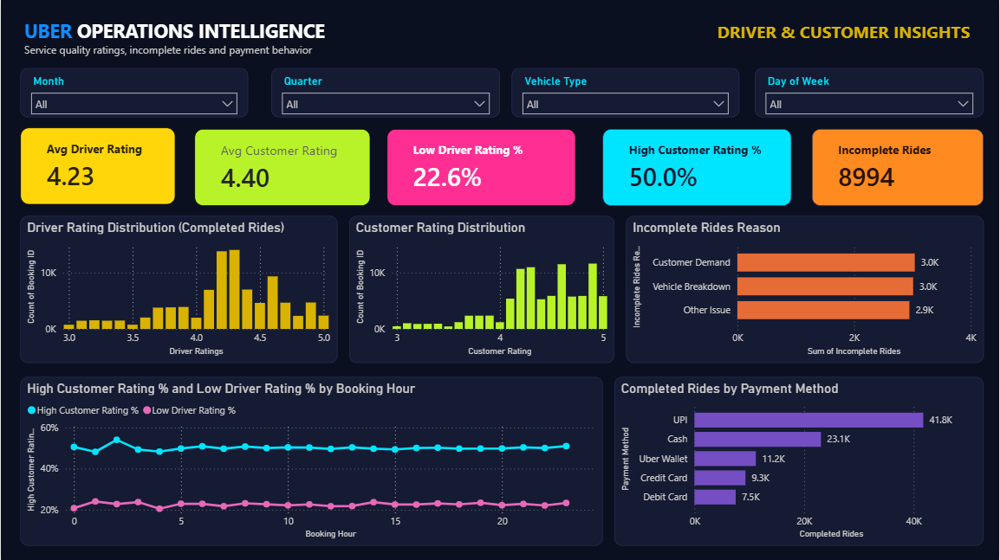
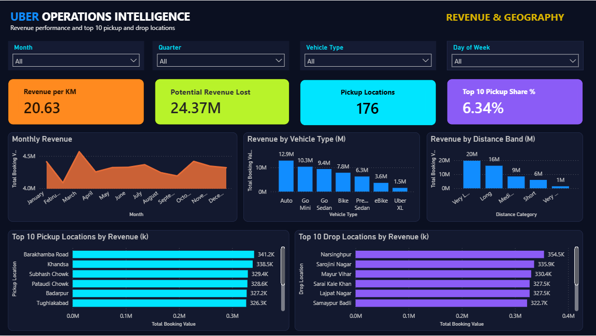

<div align="center">

# 🚖 Uber Operations Intelligence

### End-to-End Data Analytics Project

**Python · SQL · Machine Learning · Power BI**


**Booking Performance &nbsp;|&nbsp; Operations &nbsp;|&nbsp; Customer Experience &nbsp;|&nbsp; Revenue & Geography**

*Built by **Ashutosh Arpit***

[📊 Dashboard](#-power-bi-dashboard) · [🔍 Key Findings](#-key-findings) · [🤖 ML Experiments](#-machine-learning-experiments) · [🗂️ Repository](#%EF%B8%8F-repository-structure) · [👤 Author](#-author)

</div>

---

## 📌 At a Glance

| | |
|---|---|
| **Dataset** | ~150,000 ride-booking records (calendar year 2024) |
| **Dashboard** | 4 pages · 23 DAX measures · 4 filters on every page · Top 10 location rankings |
| **Analysis layers** | Python EDA → SQL → ML experiments → Power BI |
| **Core question** | What is happening across the ride-booking operation, and where is value lost? |

> **Project focus:** Understand what is happening across the ride-booking operation, identify patterns worth investigating, and communicate the findings through an interactive dashboard. Machine-learning experiments are treated as **evaluation exercises, not successful predictive systems**, because the tested features showed limited predictive signal.

---

## 📑 Table of Contents

- [Project Overview](#-project-overview)
- [Business Questions](#-business-questions)
- [Tools and Technologies](#-tools-and-technologies)
- [Dataset](#-dataset)
- [Project Workflow](#-project-workflow)
- [Power BI Dashboard](#-power-bi-dashboard)
- [Key Findings](#-key-findings)
- [Machine-Learning Experiments](#-machine-learning-experiments)
- [Repository Structure](#%EF%B8%8F-repository-structure)
- [How to Explore the Project](#-how-to-explore-the-project)
- [Data Quality and Limitations](#-data-quality-and-limitations)
- [What I Learned](#-what-i-learned)
- [Future Improvements](#-future-improvements)
- [Author](#-author)

---

## 🎯 Project Overview

Ride-booking platforms need to monitor more than total bookings. They also need to understand completion performance, cancellation patterns, incomplete rides, booking value, ride distance, vehicle categories, and customer and driver ratings.

This project uses booking-level data to examine those areas and presents the results in a business-friendly format.

### Objectives

- ✅ Measure overall booking and ride-completion performance.
- ✅ Compare booking outcomes, including customer cancellations, driver cancellations and incomplete bookings.
- ✅ Explore operational patterns across time, locations, vehicle types and payment methods.
- ✅ Investigate relationships between the available numerical features and booking value.
- ✅ Test machine-learning approaches and evaluate their actual performance.
- ✅ Build a Power BI report with operational KPIs and supporting breakdowns.

---

## ❓ Business Questions

<details>
<summary><b>Click to expand the 8 questions that guided the analysis</b></summary>

<br>

1. How many bookings were recorded, and how many were completed?
2. What share of bookings resulted in completed rides?
3. How do customer cancellations, driver cancellations and incomplete rides contribute to booking outcomes?
4. How do booking patterns vary by hour, month, pickup/drop location and vehicle type?
5. How is booking value distributed across completed rides and payment methods?
6. What do driver and customer rating distributions show?
7. Do the available numerical features provide a useful signal for predicting booking value?
8. How well can booking outcomes be classified using the information in the dataset, and what limitations affect the results?

These questions guide the analysis; they should not be interpreted as proof of causation.

</details>

---

## 🧰 Tools and Technologies

| Tool | Purpose |
|---|---|
| 🐍 **Python** | Data cleaning, exploration, analysis and machine-learning experiments |
| 🐼 **Pandas & NumPy** | Data manipulation and numerical analysis |
| 📈 **Matplotlib & Seaborn** | Exploratory visualizations |
| 📓 **Jupyter Notebook** | Reproducible, step-by-step analysis |
| 🗄️ **MySQL / MySQL Workbench** | SQL-based querying and business analysis |
| 🔧 **Power Query** | Data preparation for Power BI |
| 📊 **Power BI** | KPI reporting, interactive visual analysis and dashboard presentation |
| 🧮 **DAX** | Measures, date table and report calculations |
| 🤖 **Scikit-learn** | Model training and evaluation |

---

## 📂 Dataset

The project uses a ride-booking dataset with approximately **150,000 booking records** covering booking date and time, booking status, vehicle type, pickup and drop locations, wait and trip timing metrics, cancellation and incomplete reasons, booking value, ride distance, ratings and payment method.

<details>
<summary><b>Fields used in the analysis</b></summary>

<br>

- `Booking ID`, `Date`, `Time`, `Booking Status`
- `Vehicle Type`, `Pickup Location`, `Drop Location`
- `Avg VTAT`, `Avg CTAT`
- `Booking Value`, `Ride Distance`
- `Driver Ratings`, `Customer Rating`
- `Payment Method`
- Customer and driver cancellation fields, and incomplete-ride fields

</details>

> **Data note:** The dataset contains missing values, particularly in booking value and ride distance. These fields are recorded only for completed and incomplete rides, so missing values were treated as a data-quality consideration rather than being assumed to be zero.

If the source dataset is not licensed for public redistribution, do not commit it to GitHub. Provide instructions for obtaining it from an authorized source instead.

---

## 🔄 Project Workflow



### 1️⃣ Python EDA

📓 Notebook: `Notebooks/01_Dataset_understanding.ipynb`

The exploratory analysis examines:

- Dataset structure, data types, missing values and duplicates
- Booking-status distribution
- Booking patterns over time
- Vehicle-type and location breakdowns
- Cancellation and incomplete-ride patterns
- Booking value, ride distance and rating distributions
- Relationships among numerical variables

### 2️⃣ SQL Analysis

📁 Folder: `SQL/ride_booking_analysis/`

SQL queries investigate booking outcomes and operational breakdowns directly in MySQL. This gives a separate analytical layer and shows the ability to translate business questions into queries.

### 3️⃣ Machine-Learning Experiments

- **A. Ride completion prediction (classification):** `Notebooks/Ride_Completion_Prediction.ipynb`. Evaluated whether the available booking fields could predict ride completion, while checking for data leakage.
- **B. Booking value prediction (regression):** `Notebooks/Booking_Value_Regression.ipynb`. Compared Linear Regression, Ridge Regression and Random Forest Regression using error metrics and R².

Results are interpreted cautiously. Weak model performance is documented as a finding and a limitation of the available features, not presented as a successful production prediction system.

### 4️⃣ Power BI

The data and derived fields feed 23 DAX measures and a four-page report covering booking outcomes, operations, customer and driver quality, and revenue and geography.

---

## 📊 Power BI Dashboard

**Report name:** Uber Operations Intelligence
**Pages:** 4 · **Measures:** 23 · **Shared design:** same header, four filters (Month, Quarter, Vehicle Type, Day of Week) and colour system on every page

The report moves the reader from a high-level view of booking performance to operations, then to service quality, then to revenue and location detail.

| # | Page | Question it answers | Key visuals |
|:-:|---|---|---|
| 1 | **Executive Overview** | How is the business performing overall? | KPI cards, completion gauge, booking-status donut, monthly trend |
| 2 | **Operations Analysis** | When is demand highest and why do bookings fail? | Hourly demand, cancellation reasons, VTAT vs CTAT |
| 3 | **Driver & Customer Insights** | How good is the service quality? | Rating distributions, low/high rating share, incomplete-ride reasons |
| 4 | **Revenue & Geography** | Where does the money come from? | Revenue trend, revenue per km, Top 10 pickup and drop locations |

### 🟣 Page 1: Executive Overview

*Key performance indicators across bookings, completions, cancellations and revenue.*



<details>
<summary><b>What this page shows</b></summary>

<br>

- Six KPI cards: Total Bookings, Completed Rides, Completion Rate, Total Booking Value, Avg Completed Ride Value, Avg Driver Rating
- Completion-rate gauge and booking-status donut
- Monthly bookings vs completed rides
- Bookings by vehicle type, revenue by payment method, and where bookings are lost (customer cancellations, driver cancellations, no driver found)

**Headline numbers:** 148,767 bookings · 92,551 completed · 62.21% completion rate · about 51.8M total booking value.

</details>

### 🔵 Page 2: Operations Analysis

*Peak hours, wait times, cancellation reasons and trip profile.*



<details>
<summary><b>What this page shows</b></summary>

<br>

- KPI cards: Average VTAT, Average CTAT, Avg Completed Ride Distance, Customer and Driver Cancellation Rate, No Driver Found
- Bookings by hour of day
- Why drivers cancel and why customers cancel
- Wait time (VTAT) vs trip time (CTAT) by vehicle type
- Bookings by day of week and by distance band

**Headline numbers:** bookings peak at 18:00 (12,390) with a smaller peak at 10:00. Driver cancellations are 18.12% of bookings against 7.06% for customers.

</details>

### 🟢 Page 3: Driver & Customer Insights

*Service quality ratings, incomplete rides and payment behavior.*



<details>
<summary><b>What this page shows</b></summary>

<br>

- KPI cards: Avg Driver Rating, Avg Customer Rating, Low Driver Rating %, High Customer Rating %, Incomplete Rides
- Driver and customer rating distributions
- Why rides end incomplete
- Low driver ratings vs high customer ratings by hour
- Completed rides by payment method

**Headline numbers:** average driver rating 4.23 and customer rating 4.40. UPI is the most used payment method (about 45% of completed rides).

</details>

### 🟠 Page 4: Revenue & Geography

*Revenue performance and top 10 pickup and drop locations.*



<details>
<summary><b>What this page shows</b></summary>

<br>

- KPI cards: Revenue per KM, Potential Revenue Lost, Pickup Locations, Top 10 Pickup Share %
- Monthly revenue, revenue by vehicle type and by distance band
- **Top 10 pickup** and **Top 10 drop** locations ranked by Total Booking Value (Top N filters)

**Headline numbers:** about 20.6 revenue per km. Potential revenue lost to cancellations and no-driver bookings is an estimated 24.4M. Revenue is spread across 176 locations, and the top 10 pickups hold only about 6.3% of it.

</details>

### 🧮 KPI definitions (DAX)

<details>
<summary><b>Click to view the core measures</b></summary>

<br>

| Measure | Definition |
|---|---|
| **Total Bookings** | Distinct count of `Booking ID` |
| **Completed Rides** | Total Bookings where status is *Completed* |
| **Customer / Driver Cancellations** | Total Bookings where status is *Cancelled by Customer* / *Cancelled by Driver* |
| **No Driver Found** | Total Bookings where status is *No Driver Found* |
| **Completion Rate** | Completed Rides ÷ Total Bookings |
| **Customer / Driver Cancellation Rate** | Relevant cancellations ÷ Total Bookings |
| **Total Booking Value** | Sum of recorded `Booking Value` |
| **Avg Completed Ride Value / Distance** | Average booking value / ride distance for completed rides |
| **Avg Driver / Customer Rating** | Average of non-blank ratings |
| **Average VTAT / CTAT** | Average vehicle and customer turnaround times |
| **Incomplete Ride** | Total Bookings where status is *Incomplete* |
| **Low Driver Rating %** | Share of rated rides with a driver rating below 4.0 |
| **High Customer Rating %** | Share of rated rides with a customer rating of 4.5 or higher |
| **Revenue per KM** | Total Booking Value ÷ total ride distance |
| **Potential Revenue Lost** | (Customer cancellations + Driver cancellations + No Driver Found) × Avg Completed Ride Value. An estimate, not an accounting figure |
| **Pickup Locations** | Distinct count of pickup locations |
| **Top 10 Pickup Share %** | Revenue of the top 10 pickup locations ÷ total revenue |

KPI values change with report filters. Check the measure definitions and status labels in the PBIX before quoting any number outside the report.

</details>

---

## 🔍 Key Findings

### From the dashboard

| 🏁 Finding | 📈 Evidence |
|---|---|
| **About 6 in 10 bookings complete** | 92,551 of 148,767 bookings (62.21%) |
| **Driver cancellations are the biggest leak** | 26,963 bookings (18.12%), roughly 2.6 times the customer cancellations (10,496, 7.06%) |
| **Evening rush dominates demand** | 18:00 is the peak hour with 12,390 bookings; late night (00:00-04:00) is about one-ninth of that |
| **Rides are long and steady** | Average completed ride is 26.0 km and about 508 in value; monthly revenue stays between 4.1M and 4.6M |
| **Potential revenue lost is large** | About 24.4M (estimated) from cancellations and no-driver bookings |
| **Drivers are rated lower than customers** | 4.23 vs 4.40; 22.6% of driver ratings are below 4.0 against 50.0% of customer ratings at 4.5 or higher |
| **Digital payments lead** | UPI is about 45% of completed rides |

### From the Python and ML analysis

- **Booking value was difficult to explain with the tested numerical features.** The linear relationships between booking value and ride distance, average VTAT and average CTAT were close to zero in the tested dataset.
- **Pickup and drop demand was geographically dispersed.** The top ten pickup locations accounted for approximately 6.16% of records in the relevant location analysis, while the top ten drop locations accounted for approximately 6.08%.
- **Rating averages were similar across vehicle types** at the two-decimal level. This does not mean the full rating distributions are identical.
- **The tested booking-value regression models performed weakly.** R² was approximately 0.05 for Linear and Ridge Regression and 0.038 for Random Forest Regression.
- **The ride-completion classifier showed limited signal.** After leakage checks and removing problematic predictive signals, accuracy was approximately 62% with ROC-AUC around 0.50, which is close to chance-level discrimination.

> These are descriptive results from the project's analyses, not causal claims or guarantees that the same patterns will hold for another dataset or time period.

---

## 🤖 Machine-Learning Experiments

The project includes **two separate modelling experiments**. They address different targets and should be interpreted independently.

### A. Ride Completion Prediction (Classification)

📓 **Notebook:** `Notebooks/Ride_Completion_Prediction.ipynb`

- Explored whether the available booking fields could predict ride completion.
- Reviewed feature selection and checked for potential data leakage.
- After removing problematic predictive signals, performance was approximately **62% accuracy**, with **ROC-AUC around 0.50**.

**Interpretation:** the tested features provided limited useful signal for distinguishing the target classes. The results highlight why leakage checks and realistic evaluation matter; they do **not** support claiming a strong ride-completion predictor.

> 💡 **Takeaway:** feature selection should reflect the actual point in the booking lifecycle at which a prediction would be made. Variables that reflect events after the outcome is known can make a model look useful while making it unusable in real time.

### B. Booking Value Prediction (Regression)

📓 **Notebook:** `Notebooks/Booking_Value_Regression.ipynb`

Compared Linear Regression, Ridge Regression and Random Forest Regression.

| Model | MAE | RMSE | R² |
|---|---:|---:|---:|
| Linear Regression | 278.243 | 389.297 | 0.050 |
| Ridge Regression | 278.199 | 389.252 | 0.050 |
| Random Forest Regression | 279.363 | 391.684 | 0.038 |

**Interpretation:** all three models showed weak predictive performance, with R² values close to zero. Ridge Regression was marginally better on MAE and RMSE, but the difference was very small. The results suggest that the tested features do not explain booking-value variation well enough for a reliable predictive model.

Supporting files: `Data/Processed/booking_value_regression_features.csv` and `Data/Processed/booking_value_model_comparison.csv`. MAE and RMSE are in the same units as the target variable, so confirm the dataset's currency or unit before interpreting their absolute size.

---

## 🗂️ Repository Structure

```text
Uber_Analytics_Dashboard/
├── Data/
│   ├── Raw/
│   │   └── uber_ride_data.csv
│   └── Processed/
│       ├── uber_ride_data.csv
│       ├── booking_value_model_comparison.csv
│       └── booking_value_regression_features.csv
├── Notebooks/
│   ├── 01_Dataset_understanding.ipynb
│   ├── Ride_Completion_Prediction.ipynb
│   └── Booking_Value_Regression.ipynb
├── SQL/
│   └── ride_booking_analysis/
├── PowerBI/
│   └── Uber_Operations_Intelligence.pbix
├── Dashboard_Images/
│   ├── 01_executive_overview.PNG
│   ├── 02_operations_analysis.PNG
│   ├── 03_driver_customer_insights.PNG
│   └── 04_revenue_geography.PNG
└── README.md
```

| Folder | Contents |
|---|---|
| 📁 **Data/Raw** | Original booking dataset |
| 📁 **Data/Processed** | Cleaned dataset plus the regression feature table and model-comparison results |
| 📁 **Notebooks** | Dataset understanding (EDA), ride-completion classification, booking-value regression |
| 📁 **SQL** | MySQL queries for the ride-booking analysis |
| 📁 **PowerBI** | The 4-page Power BI report |
| 📁 **Dashboard_Images** | Dashboard screenshots shown in this README |

> Folder and file names are case-sensitive on GitHub. The dashboard screenshots only show if they are in `Dashboard_Images/` with exactly the names above.

---

## 🚀 How to Explore the Project

| Step | Action |
|:-:|---|
| 1️⃣ | **Review the screenshots** above for a quick overview without opening Power BI |
| 2️⃣ | **Review the notebooks** in `Notebooks/` to follow the data checks (`01_Dataset_understanding`), the leakage-checked classification experiment and the booking-value regression |
| 3️⃣ | **Open the SQL files** in `SQL/ride_booking_analysis/` using MySQL Workbench. Create or select the schema and import the authorized source dataset before running queries |
| 4️⃣ | **Open `PowerBI/Uber_Operations_Intelligence.pbix`** in Power BI Desktop to inspect the pages, measures, filters and interactions |
| 5️⃣ | **Check the limitations** before drawing conclusions or quoting model metrics |

<details>
<summary><b>Reproducing the Python analysis</b></summary>

<br>

Create and activate a Python environment, then open the notebooks in Jupyter:

```bash
pip install pandas numpy matplotlib seaborn scikit-learn jupyter
jupyter notebook
```

Exact package versions may differ from the original environment. For reproducible results, record the versions used or add a `requirements.txt`.

</details>

---

## ⚠️ Data Quality and Limitations

<details>
<summary><b>Click to expand</b></summary>

<br>

- Missing booking values and ride distances are tied to booking outcomes (they are recorded only for completed and incomplete rides) and should not be replaced with zero.
- **Total Booking Value includes the value recorded for incomplete rides**, while Avg Completed Ride Value uses completed rides only.
- About 1,200 rows repeat a `Booking ID` already present in the 150,000 rows. Because Total Bookings is a distinct count, it reads 148,767 rather than 150,000, and some IDs appear under more than one status.
- Cancellation and incomplete-reason codes should not be given meanings without a reliable data dictionary.
- Ratings exist only for completed rides, so averages represent records with available ratings.
- Potential Revenue Lost is an estimate that assumes each lost booking would have earned the average completed-ride value.
- Correlation describes association, not causation.
- Machine-learning metrics apply to the particular data split, features and preprocessing used.
- Weak predictive performance means the tested features were insufficient; it does not prove prediction is impossible with richer data.
- Many results are very evenly spread across vehicle types, hours, weekdays and locations, so patterns should not be over-interpreted. The dataset's source, date coverage and permission to redistribute should be documented before making the repository public.

</details>

---

## 🎓 What I Learned

- Building an end-to-end workflow across Python, SQL, machine learning and Power BI
- Cleaning and exploring a real-world-style operational dataset with missing values
- Translating operational questions into SQL queries and DAX measures
- Designing a multi-page dashboard around KPIs and business questions, with a consistent layout and colour system
- Avoiding repeated metrics across pages so each page adds something new
- Evaluating regression and classification models with appropriate metrics
- Recognizing target leakage and avoiding exaggerated model claims
- Communicating findings and limitations clearly to a business audience

---

## 🔮 Future Improvements

- [ ] Add a documented, reproducible data-refresh process
- [ ] Improve the data dictionary and map reason codes where reliable definitions exist
- [ ] Investigate richer booking-time features for prediction and validate them with time-aware splits
- [ ] Add statistical tests or confidence intervals where appropriate
- [ ] Add page navigation buttons, drill-through pages and tooltips to the dashboard
- [ ] Add pickup-to-drop route analysis and location-level cancellation rates
- [ ] Record package versions and the final data date range

---

## 👤 Author

<div align="center">

### **Ashutosh Arpit**

*Data Analytics Portfolio Project*

**Skills demonstrated:** Python · Pandas · NumPy · EDA · SQL · Scikit-learn · Power Query · DAX · Power BI · Data Visualization · Business Analysis

</div>

---

<div align="center">

*This project is intended for portfolio and learning purposes. Findings are limited to the dataset and methods used in the analysis.*

</div>
